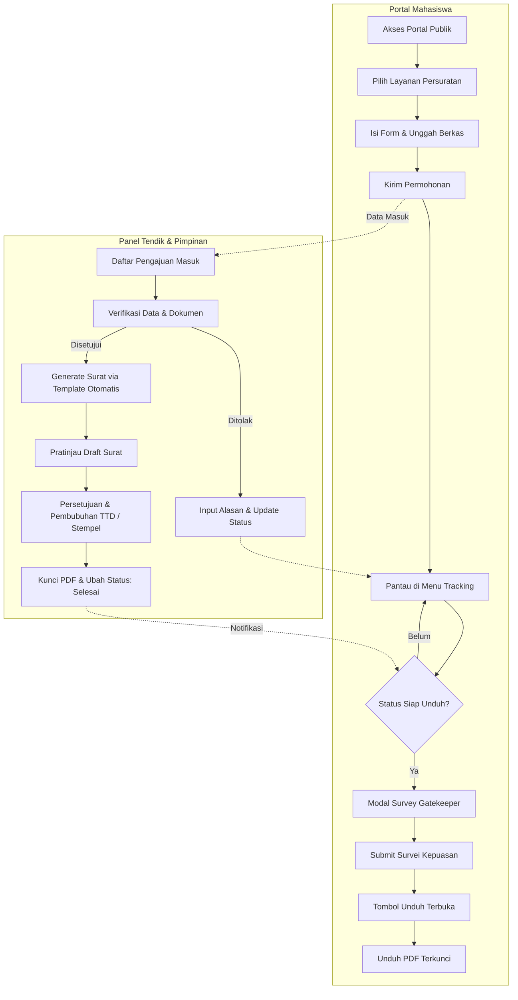

# SPESIFIKASI KEBUTUHAN SISTEM (REQUIREMENTS ANALYSIS DOCUMENT)
## Sistem Informasi Layanan Terpadu FSTI (Fakultas Sains dan Teknologi Informasi)

---

### Informasi Dokumen
- **Judul Dokumen:** Analisis Kebutuhan Sistem Informasi Layanan Terpadu FSTI
- **Mata Kuliah / Proyek:** IS Capstone (Semester 7)
- **Sumber Data Acuan:** Transkrip Wawancara Ke-2 dengan Bu Desy (Staf Tendik / Pengelola Layanan FSTI)
- **Dosen Pengampu:** Pak Idil
- **Tanggal Analisis:** 15 Oktober 2026
- **Status Dokumen:** *Approved Draft / Siap Implementasi*

---

## 1. Pendahuluan & Latar Belakang

### 1.1 Latar Belakang Masalah (Eksisting)
Proses pelayanan administrasi persuratan mahasiswa di Fakultas Sains dan Teknologi Informasi (FSTI) saat ini masih mengandalkan kombinasi alat kerja terpisah (*disjointed tools*) seperti Google Forms, Google Sheets, dan Google Docs:
1. **Beban Kerja Manual Tendik:** Mahasiswa mengisi formulir via Google Form, data terkumpul di Google Sheets, lalu staf tendik harus membuka lembar kerja dan menyalin (*copy-paste*) data satu per satu (Nama, NIM, Program Studi, Keperluan, dsb.) ke dalam Google Docs/Word sebelum dicetak atau disimpan.
2. **Ketergantungan Dua Sistem Berbeda:** Pada layanan tertentu seperti KHS/Transkrip, tendik harus masuk secara manual ke sistem akademik "Gerbang", mengunduh berkas, dan memindahkannya ke lembar layanan. Integrasi ini membutuhkan API khusus yang saat ini belum siap secara resmi.
3. **Risiko Privasi Data Pelacakan:** Pada prototipe awal, fitur pelacakan (*tracking*) belum memiliki isolasi akses yang ketat, sehingga ada potensi mahasiswa dapat melihat riwayat atau data pemohon lain.
4. **Keamanan Aset Tanda Tangan:** Dokumen hasil masih berisiko diekstrak tanda tangan atau stempelnya apabila didistribusikan dalam format terbuka (bukan *locked/flattened PDF*).
5. **Kepatuhan Pengisian Evaluasi Rendah:** Survei kepuasan layanan sering kali diabaikan oleh pemohon setelah berkas surat berhasil diperoleh.
6. **Kebutuhan Aksesibilitas bagi Pengguna Non-IT:** Sistem harus ramah digunakan oleh mahasiswa dan tenaga kependidikan dari berbagai latar belakang kecakapan digital, sehingga membutuhkan panduan interaktif dan video tutorial.

### 1.2 Tujuan Pengembangan Sistem
- Mentransformasi proses manual menjadi sistem otomasi berbasis templat (*automated document mail-merge*).
- Memisahkan secara tegas antara antarmuka publik mahasiswa dan panel administrasi tendik/pimpinan.
- Menetapkan prioritas rilis pada **Layanan Persuratan Mandiri Mahasiswa** (dimulai dari Surat Keterangan Aktif Studi).
- Menerapkan mekanisme **Survey Gatekeeper**, yaitu mewajibkan pengisian survei evaluasi sebelum surat dapat diunduh.
- Mengamankan luaran berkas akhir menggunakan PDF terproteksi (*read-only/locked*) sebelum nantinya terintegrasi penuh dengan Tanda Tangan Elektronik (TTE) tersertifikasi.

---

## 2. Profil Stakeholder & Pengguna Sistem

| Stakeholder / Aktor | Deskripsi Peran | Kepentingan & Hak Akses |
| :--- | :--- | :--- |
| **Mahasiswa (Pemohon)** | Mahasiswa aktif FSTI yang memerlukan layanan administrasi persuratan. | Mengakses portal layanan, mengisi formulir pengajuan, memantau progres surat milik pribadi, mengisi survei evaluasi, dan mengunduh berkas PDF akhir. |
| **Tenaga Kependidikan / Tendik (Verifikator L1)** | Staf tata usaha & administrasi FSTI yang memproses permohonan harian. | Memeriksa validitas berkas/data pemohon, memicu pembuatan draft surat otomatis (*generate document*), melakukan koreksi berkas, dan meneruskan ke pimpinan. |
| **Pimpinan / Atasan (Verifikator L2 / Approver)** | Dekan / Wakil Dekan / Koordinator Layanan FSTI. | Memberikan persetujuan akhir (*approval*), menyematkan tanda tangan digital/stempel resmi, dan menerbitkan surat untuk mahasiswa. |
| **Administrator IT / Pengembang** | Tim IT Capstone FSTI. | Mengelola master template surat, hak akses akun tendik/pimpinan, bank peraturan, dan pemeliharaan sistem. |
| **Dosen Pengampu (Pak Idil)** | Dosen pembimbing capstone & pengarah arsitektur layanan. | Menentukan batasan ruang lingkup (*scope boundary*), standar kualitas rekayasa perangkat lunak, dan arahan fitur layanan dosen di masa mendatang. |

---

## 3. Spesifikasi Kebutuhan Fungsional (Functional Requirements)



### 3.1 Modul 1: Portal Layanan Mahasiswa (Front-Office)
- **FR-01.1 (Arsitektur Rute Terisolasi):** Portal publik mahasiswa dan panel admin wajib dipisahkan pada rute/subdomain yang berbeda (tidak menampilkan tombol/link login admin secara sembarangan di beranda mahasiswa).
- **FR-01.2 (Navigasi Sederhana):** Navigasi utama portal mahasiswa berfokus pada 4 menu inti:
  1. **Layanan** (Katalog dan formulir permohonan persuratan).
  2. **Tracking** (Pelacakan status permohonan dan pusat unduh hasil).
  3. **Peraturan** (Pusat dokumen pedoman, SK, dan SOP fakultas).
  4. **Pusat Bantuan** (Panduan alur sistem & video tutorial).
- **FR-01.3 (Formulir Pengajuan Surat):** Mahasiswa dapat memilih jenis layanan persuratan dan mengisi formulir dinamis (Nama, NIM, Program Studi, Semester, Keperluan Pembuatan Surat, Kontak Aktif, dan lampiran pendukung).
- **FR-01.4 (Validasi Formulir Real-Time):** Sistem melakukan validasi format NIM, kelengkapan isian wajib, serta ekstensi berkas lampiran (PDF/JPG maksimal ukuran tertentu) sebelum data dikirim.

### 3.2 Modul 2: Pelacakan Status & Isolasi Akses Data
- **FR-02.1 (Isolasi Hak Akses Tracking):** Mahasiswa hanya diperkenankan melihat daftar dan riwayat permohonan miliknya sendiri. Akses pelacakan dilindungi melalui autentikasi akun atau validasi ganda (Kombinasi NIM + Kode/Token Unik Permohonan).
- **FR-02.2 (Siklus Status Permohonan):** Sistem menampilkan tahapan proses secara kronologis:
  - `Diajukan`: Permohonan berhasil dikirim mahasiswa, menunggu verifikasi.
  - `Diproses / Diverifikasi Tendik`: Data sedang diperiksa kelengkapannya.
  - `Menunggu Pengesahan Pimpinan`: Draft surat sudah terbentuk dan menunggu persetujuan pejabat.
  - `Siap Diunduh`: Surat selesai disahkan (syarat survei aktif).
  - `Perlu Revisi / Ditolak`: Disertai catatan rinci perbaikan dari tendik.

### 3.3 Modul 3: Otomasi Dokumen & Manajemen Templat Surat (Mail Merge Engine)
- **FR-03.1 (Pengelolaan Master Template):** Admin dapat mengunggah dan memperbarui master template dokumen persuratan dengan variabel penanda (*tags*), seperti:
  - `{{NAMA_LENGKAP}}`
  - `{{NIM}}`
  - `{{PROGRAM_STUDI}}`
  - `{{SEMESTER}}`
  - `{{KEPERLUAN}}`
  - `{{NOMOR_SURAT}}`
  - `{{TANGGAL_SURAT}}`
  - `{{NAMA_PEJABAT}}`
  - `{{NIP_PEJABAT}}`
- **FR-03.2 (Auto-fill Data Otomatis):** Sistem secara otomatis mengisi variabel template surat menggunakan data yang telah disubmit oleh mahasiswa, meniadakan proses salin-tempel manual ke Google Docs.
- **FR-03.3 (Pratinjau Draft Berkas):** Tendik dapat melihat pratinjau (*preview*) berkas hasil *render* template sebelum dokumen dialirkan ke tahap pengesahan.

### 3.4 Modul 4: Alur Verifikasi, Pengesahan & Pengamanan Dokumen
- **FR-04.1 (Verifikasi Berjenjang):**
  - **Lapis 1 (Tendik):** Memeriksa kecocokan data mahasiswa dan kelayakan syarat administrasi.
  - **Lapis 2 (Pimpinan):** Memeriksa draft surat resmi dan memberikan pengesahan final.
- **FR-04.2 (Pembubuhan Pengesahan Resmi):**
  - *Fase Transisi:* Sistem mendukung penyematan tanda tangan pimpinan (berdasarkan otorisasi login pimpinan) dan stempel resmi fakultas secara otomatis pada koordinat dokumen yang ditentukan.
  - *Fase Future-Ready:* Arsitektur sistem disiapkan untuk menerima modul **TTE (Tanda Tangan Elektronik)** bersertifikat BSrE/Kominfo saat regulasi kampus tersedia.
- **FR-04.3 (Penguncian Output Dokumen - PDF Security):** Berkas akhir yang dihasilkan wajib berformat PDF terenkripsi/ter-*flatten* (tidak berformat Word/Docs), dengan perlindungan agar tanda tangan pimpinan tidak dapat diekstrak atau dimodifikasi oleh pemohon.

### 3.5 Modul 5: Gerbang Survei Kepuasan (Survey Gatekeeper)
- **FR-05.1 (Penguncian Akses Unduh):** Tombol aksi "Unduh Berkas Surat" pada tabel tracking wajib berstatus nonaktif (*disabled / locked*) hingga mahasiswa menyelesaikan survei evaluasi.
- **FR-05.2 (Struktur Survei Ringkas & Cepat):** Kuesioner dirancang ringkas (1–2 menit pengisian) mencakup:
  - Penilaian bintang kepuasan layanan (skala 1 s/d 5 bintang).
  - Pertanyaan kepuasan: *"Apakah layanan persuratan ini cukup membantu kebutuhan Anda?"* (Pilihan ganda / Ya-Tidak).
  - Kolom saran/masukan perbaikan (opsional).
- **FR-05.3 (Bypass Berkas Pasca-Submit):** Segera setelah formulir survei berhasil disimpan ke database, sistem secara otomatis membuka gembok unduh dan mengizinkan pengunduhan dokumen asli.

### 3.6 Modul 6: Repositori Peraturan & Pedoman Akademik
- **FR-06.1 (Pusat Unduh Dokumen Resmi):** Menyediakan daftar berkas resmi FSTI (SK Dekan, Panduan KP, Pedoman Skripsi/Tugas Akhir, Template Form Resmi) yang dapat diunduh publik.
- **FR-06.2 (Fitur Pencarian Berkas):** Pengguna dapat mencari dokumen peraturan berdasarkan judul, kategori, atau tahun terbit.

### 3.7 Modul 7: Pusat Bantuan & Onboarding Pengguna Non-IT
- **FR-07.1 (Buku Panduan Pengguna Interaktif):** Menyediakan laman panduan alur permohonan yang mudah dipahami oleh pengguna non-teknis.
- **FR-07.2 (Penyematan Video Tutorial):** Menyematkan (*embed*) media video panduan penggunaan langsung pada portal utama agar mahasiswa memahami alur dari pengajuan hingga pengunduhan.

---

## 4. Spesifikasi Kebutuhan Non-Fungsional (Non-Functional Requirements)

| Parameter | Kebutuhan Spesifik |
| :--- | :--- |
| **Keamanan (Security)** | - Menerapkan autentikasi berbasis sesi/token aman.<br>- Proteksi *Insecure Direct Object References (IDOR)* pada API pelacakan surat.<br>- Pembatasan hak akses berbasis peran (*Role-Based Access Control* - RBAC) untuk Mahasiswa, Tendik, dan Pimpinan.<br>- Proteksi aset tanda tangan pimpinan (PDF flattening & pembatasan hak edit). |
| **Usabilitas (Usability)** | - Antarmuka bersih, responsif (dapat diakses ponsel & laptop), dan tidak rumit.<br>- Penyediaan panduan bergambar dan video tutorial untuk memfasilitasi pengguna non-IT.<br>- Indikator status berwarna jelas (Hijau = Selesai, Kuning = Proses, Merah = Ditolak). |
| **Kinerja (Performance)** | - Proses kompilasi template surat (*document generation*) memakan waktu < 3 detik per dokumen.<br>- Waktu muat halaman portal awal < 2 detik pada koneksi internet standar kampus. |
| **Keandalan & Integritas** | - Meniadakan kesalahan pengetikan nama/NIM berkat pemetaan langsung dari basis data formulir.<br>- Semua data riwayat permohonan dan log aksi verifikator tersimpan aman (*audit trail*). |
| **Skalabilitas & Ekstensibilitas** | - Arsitektur modular sehingga penambahan jenis surat baru cukup dengan menambahkan konfigurasi templat dan skema form.<br>- Siap diperluas untuk modul **Layanan Persuratan Dosen** dan integrasi **API Gerbang ITK** di masa depan. |

---

## 5. Rencana Tahapan Rilis (Milestone & MoSCoW Prioritization)

Sesuai komitmen dan arahan Bu Desy pada wawancara:
- **Milestone 1 (Target: Tanggal 15):** Uji coba sistem berjalan pada 1 layanan utama persuratan (Surat Keterangan Aktif Studi).
- **Milestone 2 (Target: Tanggal 28):** Presentasi kesiapan sistem penuh untuk seluruh layanan persuratan mahasiswa (siap launching).

```
+----------------------------------------------------------------------------------------------------+
|                                    PETA PRIORITAS (MoSCoW)                                         |
+----------------------------------------------------------------------------------------------------+
| MUST HAVE (Target Tgl 15):                                                                         |
|  [x] Form pengajuan Surat Keterangan Aktif Studi.                                                  |
|  [x] Penyimpanan data pengajuan ke database.                                                       |
|  [x] Mesin auto-fill template surat otomatis (pengganti Google Docs manual).                       |
|  [x] Panel verifikasi dasar untuk admin tendik.                                                    |
|  [x] Pratinjau surat & ekspor PDF aman.                                                            |
|                                                                                                    |
| SHOULD HAVE (Target Tgl 28 - Launching):                                                           |
|  [x] Formulir mandiri dokumen akademik (Transkrip, KHS, FRS, SKL) tanpa Google Form.               |
|  [x] Penambahan template surat lainnya (Surat Pengantar KP, Rekomendasi Beasiswa, Legalisasi).      |
|  [x] Isolasi halaman tracking khusus milik masing-masing mahasiswa.                                |
|  [x] Penguncian tombol unduh dengan Survey Gatekeeper (Wajib isi survei kepuasan).                 |
|  [x] Pemisahan domain/URL login admin dari portal mahasiswa publik.                                |
|  [x] Halaman Pusat Bantuan dengan video tutorial dan petunjuk bagi pengguna non-IT.                |
|  [x] Halaman Repositori Peraturan & Pedoman FSTI.                                                  |
|                                                                                                    |
| COULD HAVE (Rencana Lanjutan s/d Desember):                                                         |
|  [ ] Perluasan ke modul Layanan Persuratan Dosen (dikonsultasikan dengan Pak Idil).                |
|  [ ] Integrasi TTE resmi bersertifikat digital (Balai Sertifikasi Elektronik / BSrE).              |
|                                                                                                    |
| WON'T HAVE (Ditunda / Di luar Scope Saat Ini):                                                     |
|  [-] Integrasi background sync API otomatis dari server database Gerbang (verifikasi tetap di web).|
+----------------------------------------------------------------------------------------------------+
```

---

## 6. Matriks Ketertelusuran Kebutuhan (Requirements Traceability Matrix)

| Kode Ref | Bukti Kutipan Transkrip Wawancara Bu Desy | ID Kebutuhan | Fitur / Solusi Sistem |
| :--- | :--- | :--- | :--- |
| `[00:50 - 00:59]` | *"nah ini nanti mau dipisah sih bu, gak ada tombol ini... jadi nanti beda domainnya"* | **FR-01.1** | Pemisahan portal mahasiswa dan panel login admin/tendik. |
| `[01:04 - 01:11]` | *"trekkingnya jadi kita gak bisa lihat punya orang, jadi cuma bisa lihat punya kita sendiri"* | **FR-02.1** | Isolasi data pelacakan berbasis akun/token pribadi mahasiswa. |
| `[05:41 - 06:03]` | *"biasanya tuh kami harus pake google doc kami copy-copy tuh nama nama... bayangan saya ketika ini ada sistem template nya bisa dimasukin jadi keisi otomatis"* | **FR-03.1, FR-03.2** | Modul manajemen template dan otomasi pembuatan dokumen (*mail merge*). |
| `[06:33 - 06:45]` | *"teman-teman tendik tinggal verifikasi 'oh oke nih', atasan bisa verifikasi lagi... abis itu mahasiswa tinggal unduh"* | **FR-04.1** | Alur persetujuan bertingkat (L1 Tendik & L2 Pimpinan). |
| `[06:54 - 07:12]` | *"kami bisa mengupload tanda tangan... dokumen yang tidak bisa diextract sama mahasiswa... dokumen yang sudah terkunci"* | **FR-04.2, FR-04.3** | Penyematan tanda tangan resmi & penguncian berkas dalam format PDF aman. |
| `[07:55 - 08:14]` | *"mereka tidak boleh download hasil surat sebelum ngisi survei... gak usah banyak-banyak, cuma apakah layanan cukup membantu"* | **FR-05.1, FR-05.2** | Mekanisme Survey Gatekeeper dengan kuesioner singkat sebelum tombol unduh aktif. |
| `[08:18 - 08:51]` | *"peraturan dokumen... layanan, peraturan, tracking, survei"* | **FR-01.2, FR-06.1** | Penyediaan menu Peraturan FSTI dan struktur menu utama portal. |
| `[09:30 - 11:32]` | *"paling gak satu layanan dulu ya, layanan persuratan dulu... coba contoh tes di surat aktif studi udah bisa, baru nantikan surat-surat lainnya"* | **Milestone Tgl 15** | Prioritas pengembangan tahap pertama pada Surat Keterangan Aktif Studi. |
| `[12:54 - 13:12]` | *"bayanganku tuh ada video tutorialnya, ada panduan... aku bukan orang IT, ketika masuk sistem bisa terfasilitasi dengan panduan"* | **FR-07.1, FR-07.2** | Integrasi video tutorial & buku panduan langkah-demi-langkah bagi pengguna non-IT. |
| `[14:12 - 14:30]` | *"goal kami tuh di tanggal 28 itu mau kita presentasikan walaupun belum sosialisasi tapi di sistem ini udah siap pakai biar dilaunching"* | **Milestone Tgl 28** | Sasaran peluncuran sistem persuratan mahasiswa lengkap pada 28 Oktober. |

---

## 7. Kesimpulan & Rekomendasi Langkah Kerja

1. **Prioritas Utama Tim UI/Frontend:** Menyiapkan formulir Surat Aktif Studi, laman tracking dengan proteksi akses, modal kuesioner survei kepuasan layanan, serta halaman peraturan & bantuan.
2. **Prioritas Utama Tim Backend & Dokumen:** Mengonstruksi mesin *document merger* menggunakan template HTML-to-PDF atau Docx-to-PDF yang terkunci, serta merancang skema relasi database untuk permohonan, verifikasi, dan log survei.
3. **Koordinasi Template:** Segera meminta master template surat resmi FSTI (format Word) ke pihak Bu Desy/tata usaha untuk diintegrasikan penanda variabelnya ke dalam sistem sebelum tenggat tanggal 15.
